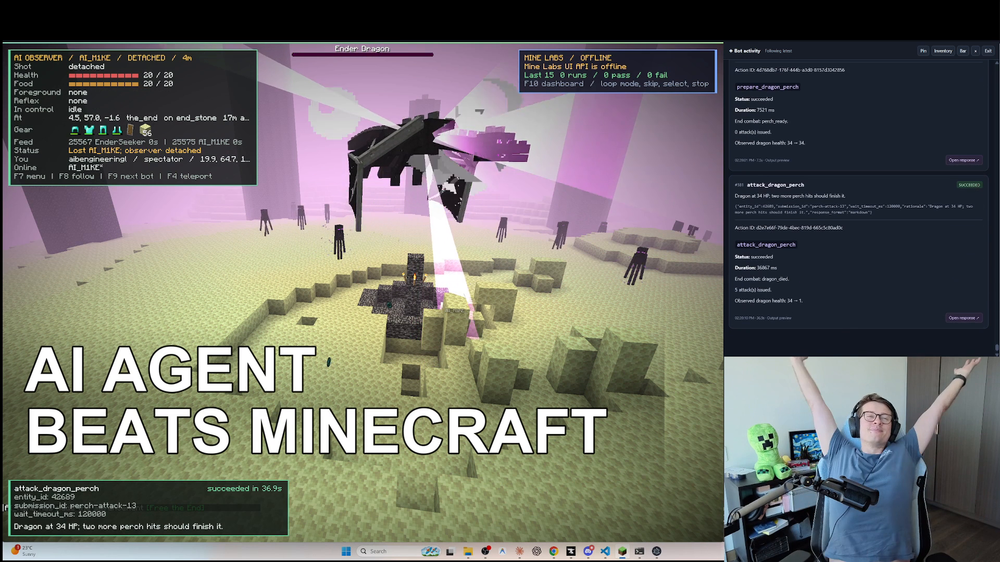

# Hey, I'm Ben — AI-BEN-gineer 👋

Australian data scientist building AI agents, solving hard problems and relentlessly learning.

I like a clear target and figuring out how to get there — through modelling, optimisation, and lots of testing and iteration.

[Find me on X](https://x.com/aibengineering) · [Join the Discord](https://discord.gg/czyFwUGUC) · [Watch the Minecraft run](https://www.youtube.com/live/ZjtwWEfFVFY)

## An AI agent beat Minecraft with the tools I built

I built **[mine-ai-mcp](https://github.com/aibengineering/mine-ai-mcp)**, an MCP server that lets an AI model request actions in Minecraft and get useful feedback on what happened.

The agent completed **vanilla Minecraft Java 1.21.4, Survival, Normal difficulty** in **3h 56m**, with one death and a successful gear recovery.

The engineering underneath:

- A TypeScript navigation system inspired by Baritone
- A combat state machine for fast reactions, steered by model policy
- Fixes to underlying Mineflayer libraries
- Useful feedback and errors so the model can make informed decisions
- Lots of testing, fixing and iterating

**[Explore the code](https://github.com/aibengineering/mine-ai-mcp)** · **[Watch the full run](https://www.youtube.com/live/ZjtwWEfFVFY)** · **[Run artifacts & world save](https://huggingface.co/datasets/aibengineering/beat-the-game-minecraft)**

## Skills & interests

| Area | What I work with |
| :--- | :--- |
| Data science & modelling | R, Python, gradient-boosted models |
| Data processing | Spark, Polars |
| Software & AI agents | TypeScript, MCP, agent tools and feedback systems |
| Problems I enjoy | Optimisation, navigation, and making systems more reliable |
| Currently learning | Rust |

---

Building, experimenting, and sharing what I learn along the way.
